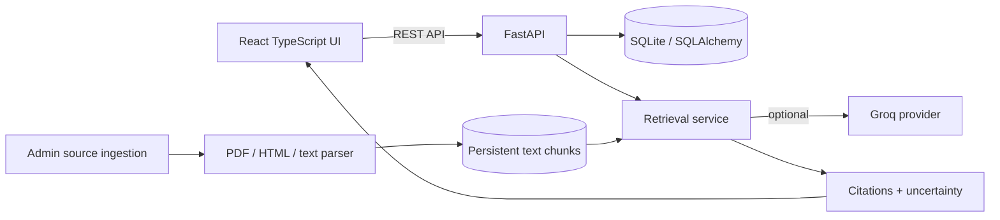
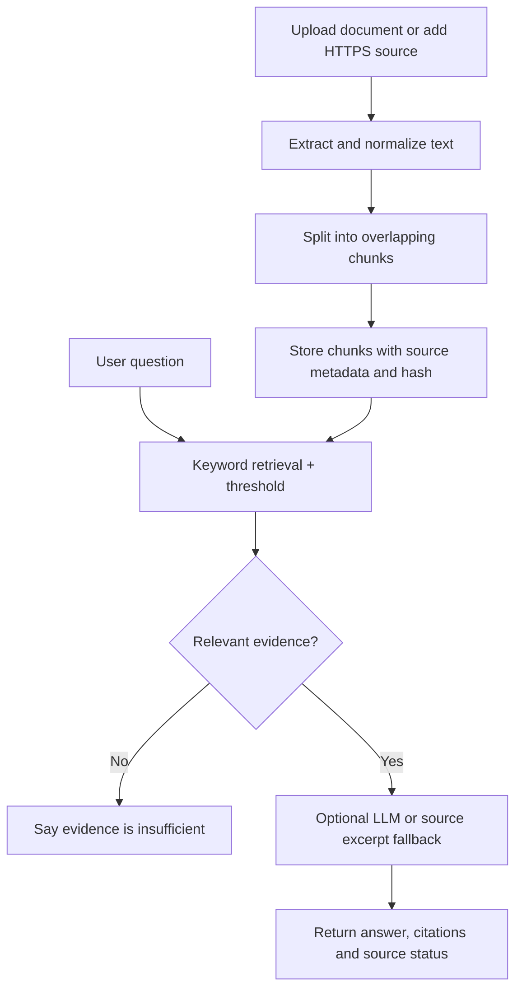

# SchemeSaarthi AI — Government Scheme & Scholarship Assistant

A local-first full-stack web app for exploring public-service portals, comparing catalogue entries, checking structured eligibility rules, preparing document checklists, and asking questions against indexed source text. Seed records are explicitly marked **Requires review** and are portal-level discovery entries—not verified individual scheme details.

> Independent information assistant only; not a government website or official eligibility decision. Verify current rules, deadlines, benefits and application instructions with the issuing authority.

## Included features

- Responsive React + TypeScript UI with desktop sidebar/mobile menu, English/Telugu/Hindi selector, light/dark theme, landing page, dashboard, search/filter/pagination, scheme and scholarship detail pages, eligibility wizard, bookmarks, checklist, comparison, source catalogue, settings, authentication, admin tools, About, Help, Privacy, and 404 route.
- FastAPI `/api/v1` API, SQLAlchemy models, SQLite persistence, scrypt password hashing, expiring bearer tokens, user-scoped saved schemes, assessments and conversations, server-side admin authorization.
- Retrieval pipeline with HTML/PDF/TXT/Markdown ingestion, text normalization, overlapping chunks, persistent source metadata, keyword relevance scoring, citations, and honest uncertainty if evidence is missing. Optional Groq LLM; keyword fallback needs no API key.
- Source records remain `requires_review` after ingestion. An administrator must explicitly review status; download success never equals verification.
- Backend pytest suite and frontend Vitest smoke test.

## Architecture



## RAG workflow



## Directory structure

```text
schemesaarthi-ai/
  frontend/                 React/Vite UI and frontend tests
  backend/
    app/                    API, database, auth, RAG, ingestion
    data/seed/              reserved seed data folder
    tests/                  API tests
    scripts_seed.py         idempotent catalogue seed script
    requirements.txt
    .env.example
  docs/DATA_POLICY.md
  scripts/start-backend.ps1
  scripts/start-frontend.ps1
  README.md
```

## Windows / VS Code installation

Install Python 3.11 or 3.12 and Node.js 20 LTS or newer. Open this root folder in VS Code.

### Backend terminal (PowerShell)

```powershell
cd backend
py -3.12 -m venv .venv
.\.venv\Scripts\Activate.ps1
python -m pip install --upgrade pip
pip install -r requirements.txt
Copy-Item .env.example .env
python scripts_seed.py
uvicorn app.main:app --reload --host 127.0.0.1 --port 8000
```

If PowerShell blocks virtual-environment activation, run `Set-ExecutionPolicy -Scope Process -ExecutionPolicy Bypass` in that terminal and activate again. Test `http://127.0.0.1:8000/health`, `http://127.0.0.1:8000/ready`, and `http://127.0.0.1:8000/docs`.

### Frontend terminal (a second PowerShell terminal from project root)

```powershell
cd frontend
Copy-Item .env.example .env
npm install
npm run dev
```

Open `http://localhost:5173`. `frontend/.env` sets `VITE_API_URL=http://127.0.0.1:8000/api/v1`. Restart Vite after changing environment values.

### Optional Groq provider

The app works without an API key. In `backend/.env`, set `LLM_PROVIDER=groq`, `LLM_API_KEY=your_key`, and `LLM_MODEL=llama-3.3-70b-versatile`. Keep the key private and never commit `.env`. If Groq is unavailable, the assistant falls back to source excerpts and says it is not using an LLM.

### Create the first admin

Set `ADMIN_BOOTSTRAP_SECRET` to a temporary value in `backend/.env`, restart the backend, then run this from PowerShell with your own email/password:

```powershell
$body = @{ bootstrap_secret = 'your-temporary-secret'; email = 'admin@example.com'; password = 'Use-A-Long-Unique-Password-123!' } | ConvertTo-Json
Invoke-RestMethod -Method Post -Uri http://127.0.0.1:8000/api/v1/admin/bootstrap -ContentType 'application/json' -Body $body
```

The endpoint is closed after an admin exists. Remove `ADMIN_BOOTSTRAP_SECRET` and restart. There are no hardcoded default credentials.

## Tests

From `backend/` with its virtual environment active:

```powershell
python -m pytest -q
```

From `frontend/`:

```powershell
npm test
npm run build
```

Tests use a local database and do not require paid LLM access.

## API endpoints

- `GET /health`, `GET /ready`
- `POST /api/v1/auth/register`, `/login`, `/logout`; `GET /api/v1/auth/me`
- `GET /api/v1/schemes`, `/search`, `/featured`, `/schemes/{id}`
- `GET /api/v1/scholarships`, `/scholarships/{id}`
- `POST /api/v1/eligibility/check`; authenticated `GET /api/v1/eligibility/history`
- Authenticated `GET /api/v1/saved`, `POST/DELETE /api/v1/saved/{scheme_id}`
- `GET/POST /api/v1/checklists`, `PATCH /api/v1/checklists/{checklist_id}/items/{item_id}`, `DELETE /api/v1/checklists/{checklist_id}`
- `POST /api/v1/schemes/compare`
- `POST /api/v1/assistant/chat`, `GET /api/v1/assistant/sessions`, `GET/DELETE /api/v1/assistant/sessions/{id}`
- `GET /api/v1/sources`, `GET /api/v1/sources/{id}`
- Admin-only source add/upload/reindex/review, ingestion jobs, metrics and bootstrap under `/api/v1/admin/...`

## Demo workflow

1. Explore the catalogue and open a portal entry. Notice the `Requires review` warning.
2. Use search and filters, then try the eligibility wizard. Since seeded entries are not scheme-specific verified rules, it should conservatively return `cannot_determine` unless a configured rule can clearly reject the profile.
3. Generate a checklist, update statuses and notes, print or export it.
4. Ask the assistant a question. With no relevant indexed chunks, it should say it cannot verify the answer rather than inventing a citation.
5. Register/log in to save schemes.
6. Bootstrap an administrator, upload a permitted public PDF/TXT/MD/HTML file or add an HTTPS URL, then re-index. Content remains unverified until reviewed.

## Official starting points and verification

- National Scholarship Portal: https://scholarships.gov.in/
- myScheme: https://www.myscheme.gov.in/
- National Government Services Portal: https://services.india.gov.in/
- National Portal of India: https://www.india.gov.in/

The seed script creates portal-level discovery records only. It does not claim current scheme rules or deadlines have been verified. Respect website terms, robots policies, rate limits and access restrictions; do not bypass logins or CAPTCHAs.

## Privacy, security and limitations

- Passwords are scrypt-hashed; tokens expire after 24 hours. Admin routes enforce authorization server-side.
- File uploads have a size cap and supported extension allowlist. Files are parsed locally; their contents are not sent to an LLM unless a user asks a question and retrieved excerpts are sent through configured Groq mode.
- Never enter Aadhaar numbers, bank details, passwords, or other sensitive identifiers. Use HTTPS, managed secrets, rate limiting, audit logging and independent security review before public deployment.
- The first release uses keyword retrieval rather than FAISS/semantic embeddings to avoid large model downloads and to work without API credentials. It provides source-grounded excerpts and citations but is not a full semantic vector database implementation. Telugu/Hindi interface translations cover the primary navigation and common messages; LLM response language depends on provider capability.
- Local catalogue/search, eligibility rules, bookmarks, checklist management, comparisons and retrieval over indexed chunks work without an LLM key. Fetching a URL requires internet; Groq requires internet and a key.

## Troubleshooting

- Python import error: activate `backend/.venv` and install `backend/requirements.txt`.
- `npm` not found: install Node.js LTS and reopen VS Code.
- Port busy: start backend on another port and update `frontend/.env`.
- CORS error: set `FRONTEND_URL` to the exact frontend origin and restart FastAPI.
- Empty catalogue: run `python scripts_seed.py` from `backend/`.
- Reset database: stop server, back up and delete `backend/data/schemesaarthi.db`, then rerun the seed script. This removes local users, bookmarks, assessments, checklists and chat history.
